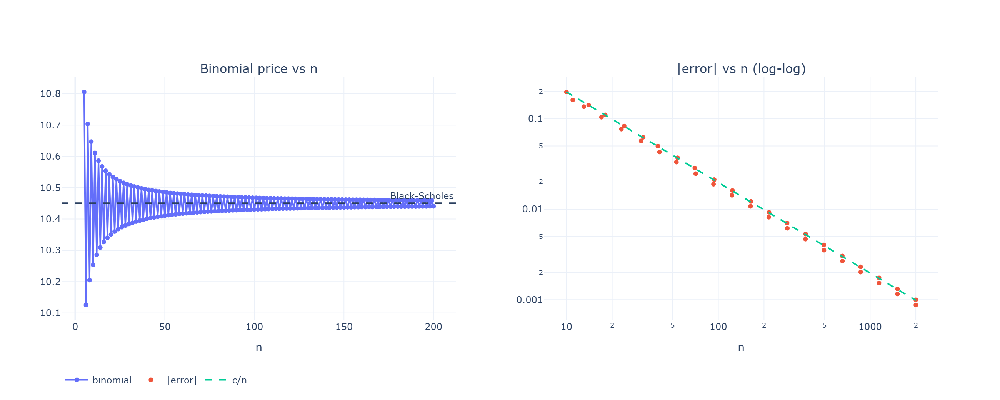
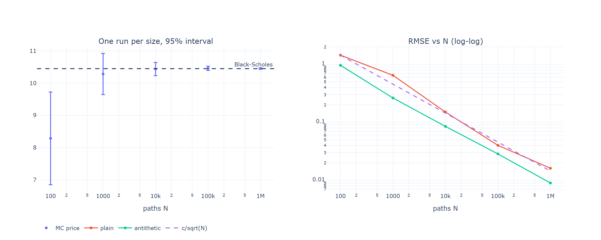
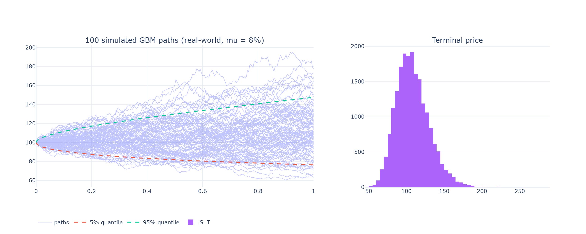
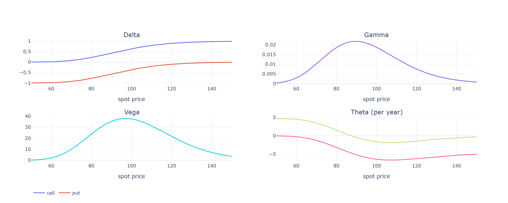

# OptionLab

[](https://github.com/Suweeby/optionlab/actions/workflows/tests.yml)

An options pricer and stock simulator in Python. It prices European options three independent
ways (Black-Scholes, a CRR binomial tree and Monte Carlo), computes Greeks and implied
volatility, simulates stock price paths under geometric Brownian motion, and compares the model
with real market data in a Streamlit app.

It is a **pricing and simulation tool, not a price predictor**, trading strategy or financial advice.

## What it does

- **Three pricers that check each other:** Black-Scholes closed form, binomial tree, Monte Carlo
  (with standard error, confidence interval and antithetic variates).
- **Greeks:** analytic delta, gamma, vega, theta, rho, verified against finite differences, plus a
  Monte Carlo (pathwise) delta.
- **Implied volatility:** Newton-Raphson using vega, with a bisection fallback.
- **One shared GBM engine, two modes:** the Monte Carlo pricer is the simulator plus a payoff.
  Pricing mode drifts at the risk-free rate `r`; simulation mode drifts at an assumed `mu`.
- **Real data, managed from the app:** download or refresh any Yahoo Finance ticker, choose a date
  range, inspect a data-quality audit, upload your own CSV and export clean data. Prices are cached
  locally with an offline fallback.
- **Model vs market:** spot price and volatility (historical and EWMA) feed the Pricer and
  Simulator; the Market Data page compares model prices with real option quotes and plots implied
  volatility by strike.
- **Audits:** every claim the project makes is backed by an automatic check, with a dated,
  reproducible report (see [Audits](#audits)).
- **Streamlit app:** Data, Pricer, Simulator, Convergence, Market Data and Audit pages.

## Figures

Generated by `scripts/generate_results.py` (fixed seeds):






## Quick start

Requires Python 3.11 or newer.

```bash
git clone https://github.com/Suweeby/optionlab.git
cd optionlab
python -m venv .venv
# Windows PowerShell: .venv\Scripts\Activate.ps1      macOS/Linux: source .venv/bin/activate
pip install -r requirements.txt
pip install -e .                         # or: pip install -e ".[app,dev]"

python -m pytest -q                      # run the tests (no network needed)
streamlit run app/streamlit_app.py       # launch the app
python scripts/generate_results.py       # regenerate docs/results/
python scripts/run_audit.py              # run the audits, write docs/audit/
```

Using the engine directly:

```python
from optionlab.pricing.black_scholes import call_price
from optionlab.pricing.binomial import binomial_price
from optionlab.pricing.monte_carlo import mc_price
from optionlab.greeks import greeks
from optionlab.implied_vol import implied_vol

S, K, r, sigma, T = 100, 100, 0.05, 0.2, 1.0
call_price(S, K, r, sigma, T)                                            # 10.4506
binomial_price(S, K, r, sigma, T, n=500)                                 # 10.4466
mc_price(S, K, r, sigma, T, n_paths=100_000, seed=42, antithetic=True)   # 10.4673 +- 0.0331
greeks(S, K, r, sigma, T).delta                                          # 0.6368
implied_vol(12.336, S, K, r, T)                                          # 0.25
```

## Results

All results are reproducible (fixed seeds). The validation suite runs **31 checks, all passing**,
covering the reference values, put-call parity, convergence rates, Monte Carlo calibration, GBM
moments, Greeks and implied volatility. Full tables and figures: [`docs/results/results.md`](docs/results/results.md).

European call, S = K = 100, r = 5%, sigma = 20%, T = 1 (exact value 10.4506):

| Method | Price | Error vs Black-Scholes | Standard error |
|---|---|---|---|
| Binomial tree, n = 100 | 10.4306 | -0.0200 | n/a |
| Binomial tree, n = 2,000 | 10.4496 | -0.0010 | n/a |
| Monte Carlo, N = 100,000 | 10.4205 | -0.0300 | 0.0468 |
| Monte Carlo, N = 100,000, antithetic | 10.4673 | +0.0167 | 0.0331 |
| Monte Carlo, N = 1,000,000, antithetic | 10.4565 | +0.0060 | 0.0104 |

- The binomial error shrinks like **1/n** (with a zigzag between odd and even n).
- The Monte Carlo error shrinks like **1/sqrt(N)**; 100x more paths gives 10x less error.
- Antithetic variates cut the standard error to about 0.71 of the plain estimate.

## Audits

The three pricers agreeing shows the *implementation* is right, not that the *model* fits markets.
The audits go further and check every claim the project makes, automatically:

- **Validation suite** (31 checks): reference values, parity, convergence rates, calibration.
- **Model audit:** a fourth, independent pricing method (numerical integration of the payoff
  against the lognormal density), Hull's textbook example, no-arbitrage rules over hundreds of
  random inputs, the validation suite rerun with many seeds, and a repeated Kolmogorov-Smirnov
  test that simulated log returns are normal.
- **Consistency audit:** the README's numbers match `docs/results/`, the text in the app and docs
  stays free of prediction language, and every public function has a docstring and type hints.
- **Claims registry:** each claim, where it is stated, and the check behind it. An unchecked or
  failing claim is a FAIL.

```bash
python scripts/run_audit.py            # quick mode (what CI runs)
python scripts/run_audit.py --full     # more random cases, seeds and KS tests
```

The script writes [`docs/audit/audit_report.md`](docs/audit/audit_report.md) and a JSON copy, with
a reproducibility manifest (UTC time, git commit, package versions, seeds, sizes), and exits with
code 1 on any FAIL. The Audit page in the app runs the quick audit with one click.

What the audits do **not** show: that Black-Scholes describes real markets (the Market Data page
shows where it does not), that downloaded data is correct, or that the list of checks is complete.

## Continuous integration

On every push and pull request, GitHub Actions installs the package on Ubuntu with Python 3.11,
runs `ruff check .`, the full test suite and the quick audit, and keeps the audit report as a
build artifact. Any failing test or audit check fails the build.

## Theory

Short derivations and a Ross-to-standard notation map are in [`docs/theory.md`](docs/theory.md):
no-arbitrage and the CRR tree, the limit to Black-Scholes, GBM and the `sigma^2/2` term, the
Greeks, implied volatility, Monte Carlo and antithetic variates, volatility estimation, and the
methods behind the audits (quadrature pricing, property-based testing, the KS test).

## Project structure

```
src/optionlab/
  config.py               shared defaults (tickers, rate, lookback, history limits)
  payoffs.py              call/put payoffs, moneyness
  pricing/                black_scholes.py, binomial.py, monte_carlo.py, compare.py
  simulation/             gbm.py (the shared generator), stats.py, scenario.py
  greeks.py               analytic Greeks, finite-difference checker, MC delta
  implied_vol.py          Newton-Raphson with bisection fallback
  volatility.py           historical, rolling and EWMA volatility; drift estimate
  data.py                 prices: download, cache, refresh, upload, export
  market.py               option chains: load, clean, compare with the model
  convergence.py          convergence studies
  validation.py           the validation suite
  audit/                  data, model and consistency audits, claims registry, report
app/                      Streamlit app (streamlit_app.py, ticker_select.py, pages/)
scripts/                  demos, generate_results.py, run_audit.py
tests/                    pytest suite (over 600 tests, including property-based tests)
docs/                     theory.md, limitations.md, results/, audit/
```

The engine never imports Streamlit; the app depends on the engine, not the other way round.

## Design notes

- **One GBM implementation.** The exact discretization means a European price needs one step, so
  the pricer and the simulator share `simulation/gbm.py`.
- **Reproducible randomness.** Every stochastic function takes a `seed` (int or numpy Generator).
- **Tests for random code** compare with theory within standard errors, and check interval
  coverage over many independent runs, rather than relying on lucky seeds. The audit also reruns
  the validation suite with many seeds, so results do not depend on one lucky seed.
- **Tests need no network.** A test-wide guard blocks any connection to a remote host, and tests
  use stand-ins for yfinance and temporary cache folders.
- **Honest data handling.** Synthetic sample data is always labelled and never cached. The Market
  Data page refuses synthetic data and user uploads for the model-vs-market comparison.
- **Documented code.** Public functions have docstrings and type hints; `ruff check .` is clean.

## Limitations

OptionLab assumes European exercise, no dividends and constant volatility, so real quotes (mostly
American options on dividend-paying stocks, with a volatility smile) will differ from its prices.
Expected returns cannot be estimated reliably from history, and yfinance data can be delayed or
incomplete. See [`docs/limitations.md`](docs/limitations.md) for the full list.

## Future work

- American options on the binomial tree (early exercise at each node).
- A company comparison page and correlated multi-asset simulation (reusing the one GBM step).
- Market risk analytics (value at risk, portfolios) as a separate project built on the same data layer.

## Tech stack

Python 3.11+, numpy, scipy, pandas, yfinance, plotly, streamlit, pytest, hypothesis, ruff,
GitHub Actions.

## Disclaimer

Educational software. Nothing here is financial advice or a prediction of future prices.
