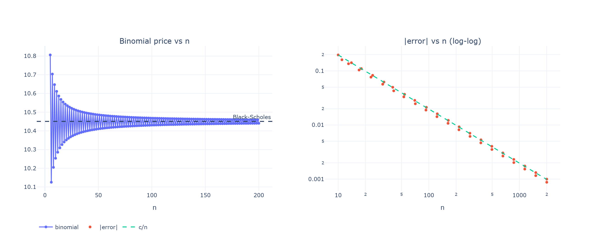
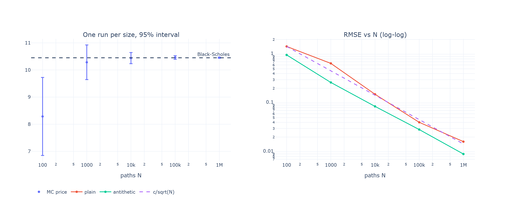
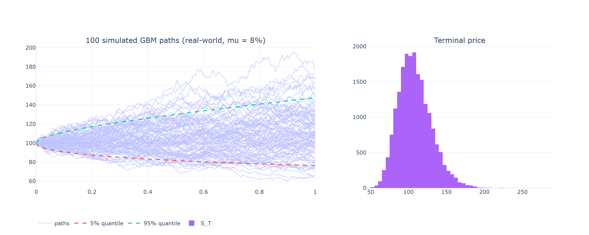
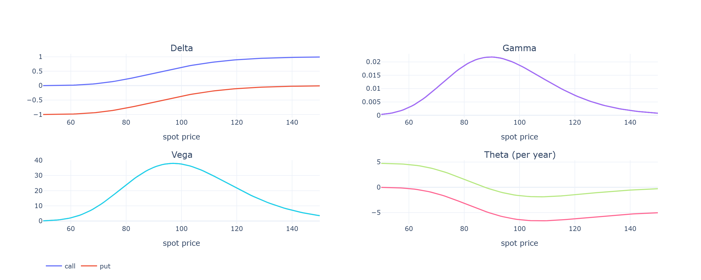

# Results

Generated by `python scripts/generate_results.py` (fixed random seeds, so reproducible).
Option: European, S = K = 100, r = 5%, sigma = 20%, T = 1 year (no dividends).

## Validation: 31 of 31 checks pass

| area | check | expected | observed | criterion | status |
| --- | --- | --- | --- | --- | --- |
| Black-Scholes | call, S=K=100, r=5%, sigma=20%, T=1 | 10.4506 | 10.4506 | abs error < 1e-4 | PASS |
| Black-Scholes | put, same inputs | 5.5735 | 5.57353 | abs error < 1e-4 | PASS |
| Black-Scholes | put-call parity C - P = S - K e^(-rT) | 4.87706 | 4.87706 | abs error < 1e-10 | PASS |
| Black-Scholes | T -> 0: call tends to intrinsic value | 10 | 10 | abs error < 1e-4 | PASS |
| Black-Scholes | sigma -> 0: call tends to discounted forward payoff | 14.3894 | 14.3894 | abs error < 1e-6 | PASS |
| Black-Scholes | deep in the money: call ~ S - K e^(-rT) | 204.877 | 204.877 | abs error < 1e-6 | PASS |
| Black-Scholes | deep out of the money: call ~ 0 | 0 | 3.4165e-15 | abs error < 1e-6 | PASS |
| Black-Scholes | negative S, K, sigma or T raise ValueError | all raise | all raise | every case raises | PASS |
| Binomial | put-call parity inside the tree (n=500) | 4.87706 | 4.87706 | abs error < 1e-9 | PASS |
| Binomial | converges to Black-Scholes (n=2000) | 0 | -0.000999797 | abs error < 3/n | PASS |
| Binomial | error shrinks like 1/n (10x steps -> 10x smaller) | 10 | 9.98861 | ratio within 25% of 10 | PASS |
| Monte Carlo | price within 3 standard errors of Black-Scholes (N=10,000) | 10.4506 | 10.3452 | |z| < 3 (z = -0.71) | PASS |
| Monte Carlo | price within 3 standard errors of Black-Scholes (N=100,000) | 10.4506 | 10.4269 | |z| < 3 (z = -0.51) | PASS |
| Monte Carlo | price within 3 standard errors of Black-Scholes (N=1,000,000) | 10.4506 | 10.4574 | |z| < 3 (z = +0.46) | PASS |
| Monte Carlo | 95% intervals contain the true price (300 runs) | 0.95 | 0.96 | coverage between 0.92 and 0.98 | PASS |
| Monte Carlo | error shrinks like 1/sqrt(N) (100x paths -> 10x smaller) | 10 | 9.98452 | ratio within 35% of 10 | PASS |
| Monte Carlo | antithetic variates reduce the standard error | ratio < 1 | 0.706779 | ratio < 0.9 | PASS |
| Monte Carlo | put-call parity holds within noise (N=200,000) | 4.87706 | 4.88861 | within 4 combined standard errors | PASS |
| GBM | mean of ln(S_T/S_0) = (mu - sigma^2/2) T | 0.06 | 0.0599547 | within 4 standard errors | PASS |
| GBM | variance of ln(S_T/S_0) = sigma^2 T | 0.04 | 0.0398214 | relative error < 2% | PASS |
| GBM | E[S_T] = S_0 e^(mu T) | 108.329 | 108.314 | within 4 standard errors | PASS |
| GBM | risk-neutral: discounted E[S_T] = S_0 | 100 | 100.06 | within 4 standard errors | PASS |
| GBM | risk-neutral P(S_T > K) = N(d2) | 0.462574 | 0.463195 | within 4 standard errors | PASS |
| Volatility | estimator recovers sigma = 30% from 40 years of daily data | 0.3 | 0.297938 | abs error < 0.01 | PASS |
| Greeks | analytic Greeks match finite differences (5 Greeks, call and put) | 0 | 2.36799e-08 | max relative difference < 1e-4 | PASS |
| Greeks | delta(call) - delta(put) = 1 | 1 | 1 | abs error < 1e-12 | PASS |
| Implied volatility | round trip: price a call at sigma=0.25, solve back | 0.25 | 0.25 | abs error < 1e-8 | PASS |
| Implied volatility | round trip: price a put at sigma=0.25, solve back | 0.25 | 0.25 | abs error < 1e-8 | PASS |
| Implied volatility | Newton-Raphson converges in a few steps at the money | <= 6 | 3 | iterations <= 6 | PASS |
| Implied volatility | bisection fallback solves the case where Newton cannot start | 0.8 | 0.8 | abs error < 1e-7, method = bisection | PASS |
| Implied volatility | price below the no-arbitrage minimum raises ValueError | raises | raises | raises | PASS |

## The three methods side by side

| method | call | call - BS | call SE | put | put - BS |
| --- | --- | --- | --- | --- | --- |
| Black-Scholes (exact) | 10.4506 | 0 | 0 | 5.57353 | 0 |
| Binomial tree, n = 100 | 10.4306 | -0.01997 | 0 | 5.55355 | -0.01997 |
| Binomial tree, n = 500 | 10.4466 | -0.004 | 0 | 5.56953 | -0.004 |
| Binomial tree, n = 2,000 | 10.4496 | -0.001 | 0 | 5.57253 | -0.001 |
| Monte Carlo, N = 10,000 | 10.3452 | -0.1054 | 0.14766 | 5.65945 | 0.08593 |
| Monte Carlo, N = 100,000 | 10.4205 | -0.03004 | 0.04677 | 5.58473 | 0.01121 |
| Monte Carlo, N = 100,000, antithetic | 10.4673 | 0.01673 | 0.03308 | 5.58185 | 0.00833 |
| Monte Carlo, N = 1,000,000, antithetic | 10.4565 | 0.00595 | 0.01042 | 5.57874 | 0.00522 |

## Binomial convergence

| n | binomial | black_scholes | error | abs_error |
| --- | --- | --- | --- | --- |
| 10 | 10.2534 | 10.4506 | -0.19717 | 0.19717 |
| 50 | 10.4107 | 10.4506 | -0.03989 | 0.03989 |
| 100 | 10.4306 | 10.4506 | -0.01997 | 0.01997 |
| 500 | 10.4466 | 10.4506 | -0.004 | 0.004 |
| 1000 | 10.4486 | 10.4506 | -0.002 | 0.002 |
| 2000 | 10.4496 | 10.4506 | -0.001 | 0.001 |

## Monte Carlo convergence

Each size repeated 20 times; RMSE is the typical actual error.

| N paths | plain: average SE | plain: RMSE | antithetic: average SE | antithetic: RMSE |
| --- | --- | --- | --- | --- |
| 100 | 1.40174 | 1.44056 | 1.03398 | 0.9659 |
| 1000 | 0.47146 | 0.6477 | 0.3339 | 0.26293 |
| 10000 | 0.14782 | 0.15065 | 0.10472 | 0.085 |
| 100000 | 0.04656 | 0.04007 | 0.0329 | 0.02847 |
| 1000000 | 0.01472 | 0.0161 | 0.0104 | 0.00898 |

## Greeks

| option | greek | analytic | finite difference | abs difference |
| --- | --- | --- | --- | --- |
| call | delta | 0.636831 | 0.636831 | 0 |
| call | gamma | 0.018762 | 0.018762 | 0 |
| call | vega | 37.524 | 37.524 | 0 |
| call | theta | -6.41403 | -6.41403 | 0 |
| call | rho | 53.2325 | 53.2325 | 1e-06 |
| put | delta | -0.363169 | -0.363169 | 0 |
| put | gamma | 0.018762 | 0.018762 | 0 |
| put | vega | 37.524 | 37.524 | 0 |
| put | theta | -1.65788 | -1.65788 | 0 |
| put | rho | -41.8905 | -41.8905 | 1e-06 |
| call | delta (Monte Carlo, pathwise) | 0.636831 | 0.635805 | 0.001025 |

## Figures

